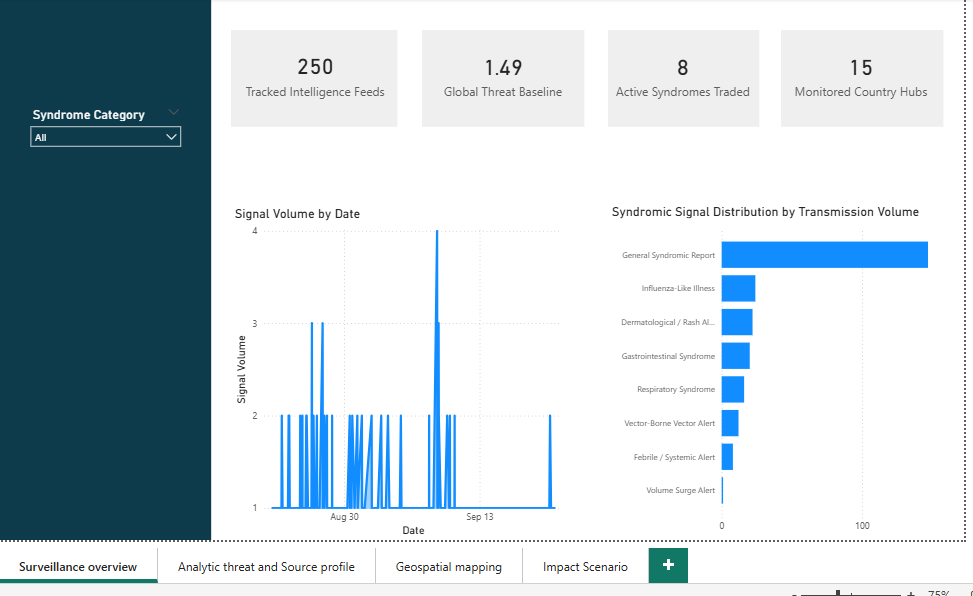
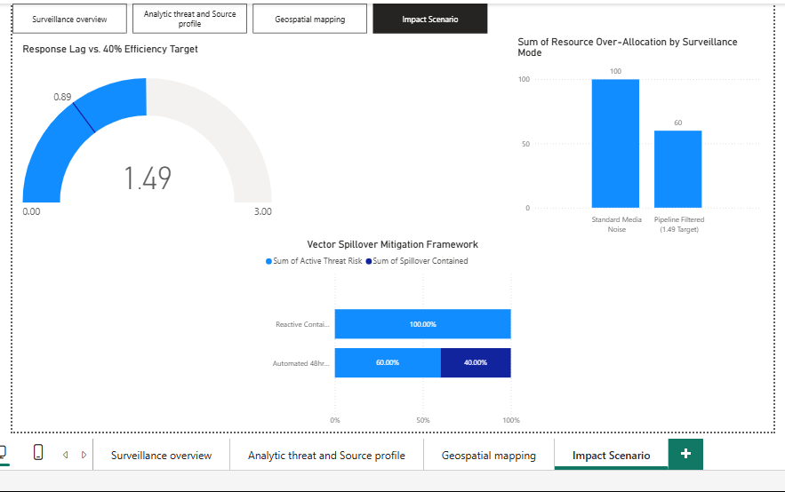

# Syndromic Surveillance & Multi-Facility Reporting Engine
An automated public health tracking framework engineered to monitor emerging anomalies and cross-border transmission risks.

## Dashboard Preview

### System Summary Canvas (Page 1)

### Multi-Facility Risk Scenario Matrix (Page 4)

---------------------------------------------------------

## The Catalyst
Disconnected and delayed regional reporting slows down outbreak responses.

## Core Observations
Processing incoming news articles isolated baseline reporting from anomalies to capture early surges and severe symptoms.

## Execution Blueprint
Used Advanced Power Query and Power BI to parse unstructured text, filter key fields, and build an integrated data model.

## Concrete Metrics
Delivers an early-warning dashboard proving preventive interventions stabilize clinical severity at 0.89 instead of reaching 1.49.

## Tech Stack Used
* Microsoft Power BI (DAX, Star Schema Modeling)
* Advanced Power Query
* Microsoft Excel
